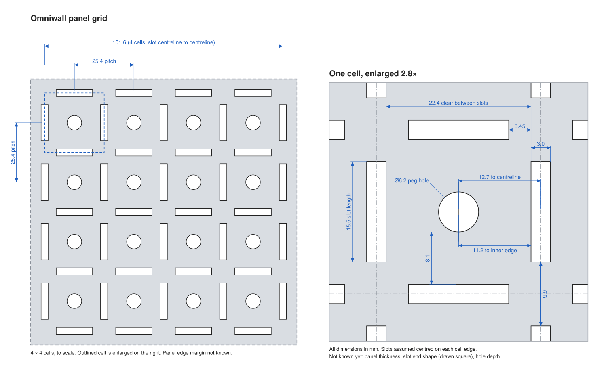

# Omniwall panel

Reference for the Omniwall wall panel that printed mounts attach to. It records
the panel's slot and peg-hole geometry, the values that follow from it, and what
is still unknown. Designs that mount to the panel should take their numbers from
[panel.yaml](panel.yaml) rather than retyping them.

## What the panel is

A flat panel with a repeating 25.4 mm (1 inch) grid. Each grid cell is boxed in
by four slots, two vertical and two horizontal, and has a round peg hole in its
middle. Neighbouring cells share slots: the right-hand vertical slot of one cell
is the left-hand slot of the next.

[panel-diagram.svg](panel-diagram.svg) shows a 4 × 4 block of cells to scale and
one cell enlarged with all the dimensions below. It's generated from
[panel.yaml](panel.yaml) by [diagram.py](diagram.py) (`python diagram.py`, needs
`pyyaml`), so rerun it after changing a value there.

## Given dimensions

These come from the project brief (stated by the panel's owner, not measured
for this document).

| Feature | Value |
|---|---|
| Slot width | 3.0 mm |
| Slot length | 15.5 mm |
| Vertical slot spacing (left edge to left edge) | 25.4 mm |
| Horizontal slot spacing (top edge to top edge) | 25.4 mm |
| Vertical and horizontal slots | Each set parallel to itself, the two sets at right angles |
| Peg hole diameter | 6.2 mm |
| Peg hole centre to inner edge of the slots | 11.2 mm |
| Panel material | 18 gauge steel |
| Panel thickness | 1.55 mm (measured with calipers) |

## Derived geometry

The enlarged cell in [the diagram](panel-diagram.svg) shows each of these.
Coordinates below put the origin at one peg hole's centre, x to the right and y
up. P = 25.4 mm (pitch), w = 3.0 mm (slot width), L = 15.5 mm (slot length).

**Clear gap between two parallel slots.** Edge-to-edge spacing minus one slot
width: P − w = 25.4 − 3.0 = **22.4 mm**.

**The hole is centred in its cell.** Half that gap is 22.4 / 2 = 11.2 mm, which
is exactly the stated hole-to-slot distance. So the two given numbers agree, and
the hole sits midway between the slots on both axes.

**Hole centre to slot centreline.** 11.2 + w/2 = 11.2 + 1.5 = **12.7 mm** = P/2.
The slot centrelines therefore lie on the grid lines at x, y = ±12.7 mm (+ n·25.4),
and the holes on a 25.4 mm grid offset by half a pitch from them.

**Hole edge to slot inner edge.** 11.2 − 6.2/2 = 11.2 − 3.1 = **8.1 mm** of solid
panel between the hole and each slot.

**Slot positions around the hole at the origin** (slots assumed centred on the
cell edge, see open questions):

| Slot | x range | y range |
|---|---|---|
| Right vertical | 11.2 to 14.2 | −7.75 to +7.75 |
| Left vertical | −14.2 to −11.2 | −7.75 to +7.75 |
| Top horizontal | −7.75 to +7.75 | 11.2 to 14.2 |
| Bottom horizontal | −7.75 to +7.75 | −14.2 to −11.2 |

The ±7.75 is L/2 = 15.5 / 2. Every other cell is this pattern shifted by whole
multiples of 25.4 mm in x and y.

**Material at the grid corners** (same centring assumption):

- A slot ends 7.75 mm from the cell's centreline, and the next slot along the
  same grid line starts at 25.4 − 7.75 = 17.65 mm. That leaves
  17.65 − 7.75 = **9.9 mm** of panel between the ends of two in-line slots.
- The end of a vertical slot (y = 7.75) is 11.2 − 7.75 = **3.45 mm** short of the
  near edge of the horizontal slot band (y = 11.2), and likewise the other way
  round. Nearest corner to corner, a vertical and a horizontal slot are
  √(3.45² + 3.45²) ≈ **4.88 mm** apart.

## Open questions

None of these were given, so no value has been assumed for them. Measure them
(calipers) before a design depends on one.

- **Space behind the panel.** How far it stands off the wall, which limits how
  deep a hook can go.
- **Slot ends.** Square, or rounded (full 1.5 mm radius or something smaller).
  This changes how long a tab can be and still seat.
- **Slot placement along the cell edge.** The derived table assumes each slot is
  centred on its cell edge (in line with the hole). It is the natural reading but
  wasn't stated.
- **Peg hole depth.** Through hole or blind, and any chamfer or countersink on
  the front.
- **Edge chamfers or radii on the slots,** front or back.
- **Manufacturing tolerance** on slot width, hole diameter and pitch, and whether
  the pitch holds across a whole panel or between joined panels.
- **Panel size and edge margin.** How many cells per panel and the distance from
  the outermost slots to the panel edge.
- **Load rating.**

## Hook names (Zeid, 2026-10-19)

Two families, named for how they hold the panel, and a size in U: the number of
housing rows the hook's dovetail front spans (one snap notch pair per row).

| Name | Was | What it is |
|---|---|---|
| **Bridge hook 1U** | bridge hook, cross-slot hook | Clamps the steel bridge between two in-line slots, its top bar resting on the upper slot's bottom edge. |
| **Bridge hook 2U** | tall bridge hook | Bridge hook 1U with its front raised 12.0 mm to the upper slot's top and a second notch pair one cell lower. |
| **Slot hook 1U** | slot hook 1, one-slot hook, the 1u hook | Fills one slot and hooks a finger over its top edge, with a rim-notch snap at the bottom. |
| **Slot hook 2U** | slot hook 2, two-slot hook | Slot hook 1U carried down into the next slot in line, snapping in the lower slot. Test print in `slot-hook-2u/`. |

All of them carry the same dovetail front, so one pocket fits any of them. For
one housing to take every hook, the snaps must sit in the same places: Slot hook
2U has a second notch pair one cell lower, and Bridge hook 2U has its front
raised 12.0 mm (`bridge_hook(size=2)`, tested in `slot-hook-2u/`). In a 2-row
housing each hook column then takes two Slot hook 1Us, one Slot hook 2U, or one
Bridge hook 2U. Bridge hook 1U's top sits 12.0 mm lower, so it fits housings
made for it (today's arc drawers) and not those.

## Official hooks

`hook/build_hooks.py` builds all four hooks from [panel.yaml](panel.yaml):
`hook/print/<name>.step/.stl/.3mf` lying on their flat side with no supports,
and `hook/step/<name>.step` as mounted (z up from the upper slot's bottom edge,
the panel's front face at y = 4.95), with the names `bridge_hook_1u`,
`bridge_hook_2u`, `slot_hook_1u` and `slot_hook_2u`. Run it from `hook/` with
`uv run --no-project --python 3.12 --with build123d --with pyyaml python build_hooks.py`.

Bridge hook 1U and Slot hook 1U were printed with the test plate
(`pocket-test/`) on 2026-10-17 and fit, snap and hold. Slot hook 2U was
printed with the coupon in `slot-hook-2u/` on 2026-10-18, its lower-foot snap
picked from two rounds of variants; Bridge hook 2U is in the same test print.
The two 1U hooks are also in the Bambu Studio project `test-prints/omniwall_test_parts.3mf` (built locally by `build_bambu_project.py`). Earlier versions are kept in
`hook/old-finger-snap/` and `hook/old-offset-head/` for reference only. Objects
take the pocket in `dovetail_mount.pocket`, built by `pocket_void()` in
`hook_geometry.py`.

## Bridge hook 1U (print-tested)

The hook in use on printed mounts. The owner's Shapr3D model is
[hook/bridge_hook_1u_measured.step](hook/bridge_hook_1u_measured.step); its measured values are
in `bridge_hook` in [panel.yaml](panel.yaml). The printed version keeps
everything behind the panel and swaps the front for a symmetric dovetail (below);
the print-ready file, lying on its flat side, is in `hook/print/`.

It engages two vertical slots in the same column. The top bar goes through the
upper slot and rests on its bottom edge, with a finger hanging behind the panel.
The finger leaves a 1.5 mm gap for the 1.55 mm steel, so the hook clamps the
panel and doesn't wobble. The foot goes through the slot below and sits under
that slot's top edge, so a bump from underneath can't lift the mount off. Bar to
foot is 10.2 mm against 9.9 mm of panel between the slots.

The owner's model has a half-dovetail tongue on the front (a 2.95 mm stem
flaring at 29° to a 7.35 mm face). Its bump snaps couldn't click: a bump on one
face only pushes the object into its clearance. The printed hook replaces it with
the dovetail and snap of the Kong 3D Skadis tray mount, measured from its 3MF:

- A spine 2.5 mm deep in front of the panel, the same 2.95 mm width as the hook,
  like the original hook's stem. The hook goes on by putting the finger
  through the upper slot and swinging the foot into the lower one. That tilts
  the top of the spine into the upper slot, so it has to fit the 3.0 mm slot.
  A 4.7 mm spine (Kong's) stopped the foot reaching its slot. Objects have a
  channel for the spine in their back, so they sit flush on the panel.
- A symmetric 45° dovetail head centred on the hook: 2.95 mm head, as wide as
  the hook, with a 1.45 mm neck (a 0.75 mm groove each side), 3.7 mm deep and a
  45° lead-in chamfer at the top. The whole front is one 2.95 mm bar, so the
  hook prints flat with no support. The head's flat sides run 2.0 mm front to
  back (Kong uses 0.55) because the head's side is the strip on the bed:
  0.55 mm lifted and printed blobby, and 1.5 mm still lifted sometimes.
  Kong's head is 4.7 mm wide. A centred 4.7 mm head would overhang both sides
  and need support under the whole hook.
  Exposed edges have 0.5 mm chamfers like the original hook (0.2 mm on the
  head's front corner, so the snap still has its flat to bear on). The bed side
  and the bottom end have none, so the first layers keep their full footprint.
- Snap: a rounded notch 0.23 mm deep across each side of the head, 2.75 mm below
  the top. Each notch stops 0.5 mm short of the head's front, so it doesn't cut
  the strip on the bed in two. The object's pocket is the spine channel and the
  dovetail, with 0.25 mm per side clearance, open at the bottom and closed at
  the top. It has a rounded ridge 0.333 mm tall on each side wall, also 2.75 mm
  below the top, ending 0.2 mm behind the notch's end. The ridges squeeze the
  head by 0.08 mm a side over the last 2 mm of travel and click into the
  notches. Because they pinch from both sides, the clearance can't absorb them.
  The pocket's lips grip 0.5 mm behind each side of the head (Kong 0.75).

Both copies of a hook are the same part (no mirrored pair), and the head sits
on the slot centre, so objects line up with the slot grid. The pockets sit a
whole number of 25.4 mm cells apart. `pocket-test/` has a test plate for the
fit; `hook_geometry.py` builds the hooks, the head and the pocket from the same
numbers. `build_bambu_project.py` packs both hooks and the test plate into a
Bambu Studio project (`test-prints/omniwall_test_parts.3mf`), one part per plate.

## Slot hook 1U (print-tested)

The owner's 1u hook, [hook/slot_hook_1u_measured.step](hook/slot_hook_1u_measured.step),
measured as `slot_hook_1u` in [panel.yaml](panel.yaml). It mounts in a single
slot, so an object can sit within one cell. A finger goes up behind the panel
above the slot, and the body fills the slot's full 15.5 mm height. A cavity open
to the back lets the foot flex as the body snaps into the slot.

The printed version (`hook/print/slot_hook_1u`) carries the same
dovetail front as Bridge hook 1U, in the same place relative to the panel,
so one pocket fits either hook. To make room for the spine, the cavity now ends
6.45 mm from the back instead of 7.51. The foot is thinned from 4.0 to 3.44 mm
so the shorter foot flexes about as easily as before. The finger and the top of the body have 0.5 mm
chamfers on the side facing up when printing and on the finger's top corners.
The foot also reaches 0.8 mm below the slot, with a 1.5 mm notch cut up into
it for the slot's bottom rim; the dovetail front reaches down to the same
bottom. The back of the foot's bottom is one 25° ramp from the top of its
lead-in to the notch. Pushing the bottom of the hook in, the ramp rides over the
rim, the foot flexes up into the cavity, and it drops with the rim in the notch.
The notch's front edge has a 0.3 mm chamfer to guide the rim in.

## Designing mounts for it

- Size printed parts that go into the panel with a clearance and test-print the
  fit first, as the repo's [AGENTS.md](../AGENTS.md) asks for critical fits.
  The official hooks above are the print-tested reference; record new tested
  fits here. Tested so far: the dovetail pocket (0.25 mm per side, 0.15 mm to
  the spine and floor, 0.333 mm snap ridges), the 1.5 mm clamp on the 1.55 mm
  steel, and Slot hook 1U's 0.8 mm rim notch.
- Tabs into slots must be narrower than 3.0 mm and shorter than 15.5 mm; how much
  smaller depends on the slot ends and the fit test.
- Pegs into the holes must be under Ø6.2 mm, again by an amount the fit test
  sets.
- Mount features repeat at 25.4 mm, so a mount can use several slots or holes on
  the same grid for stiffness and to stop it rotating.
